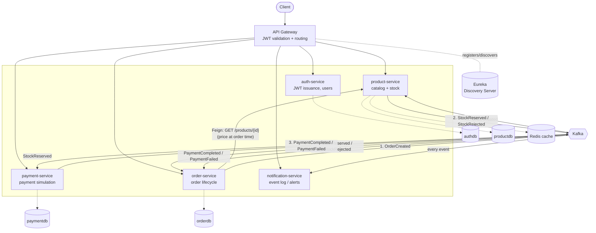

# E-Commerce Microservices Platform

A production-shaped e-commerce backend built as independently deployable Spring Boot microservices, communicating synchronously via **Eureka + OpenFeign** and asynchronously via a **Kafka-driven choreography saga**, fronted by a single **API Gateway** that terminates JWT auth for the whole system.

This isn't a CRUD demo with a "microservices" label slapped on it — placing an order actually fans out across four independent services, each owning its own database, coordinating purely through events.

## Why this exists

Most portfolio projects are a single Spring Boot app with a REST controller. This one is built to demonstrate the things a backend/cloud role actually screens for:

- Service decomposition with **database-per-service** (no service reaches into another's schema)
- **Service discovery** (Eureka) instead of hardcoded hosts/ports
- A **choreography-based saga** for the distributed transaction of "place an order" — no orchestrator, no 2PC, each service reacts to the previous one's event
- **Optimistic locking** to prevent overselling stock under concurrent orders
- **JWT auth validated once at the edge**, identity forwarded downstream via headers — services never re-verify tokens
- **Redis caching** with explicit invalidation on writes
- Fully containerized with **Docker Compose** — one command boots Postgres, Redis, Kafka, and all seven services

## Architecture



### The order saga, step by step

1. Client calls `POST /api/orders` through the gateway (JWT required). **order-service** calls **product-service** synchronously via Feign to price each line item, persists the order as `CREATED`, and publishes `OrderCreated`.
2. **product-service** consumes `OrderCreated`, tries to reserve stock inside a transaction guarded by an `@Version` column. Enough stock → decrements it and publishes `StockReserved`. Not enough → publishes `StockRejected`.
3. **order-service** consumes `StockReserved`/`StockRejected` and updates the order status accordingly.
4. **payment-service** consumes `StockReserved`, simulates a gateway charge (declines orders above a configurable limit to make the failure path demonstrable), and publishes `PaymentCompleted`/`PaymentFailed`.
5. **order-service** consumes the payment outcome and moves the order to `CONFIRMED` or `CANCELLED`.
6. **notification-service** listens to every event in the chain and logs/exposes a customer-facing notification for each — it never mutates state, only observes it.

No service blocks waiting for another. If payment-service is down, `StockReserved` events sit in Kafka until it comes back up — the order simply stays `STOCK_RESERVED` until then.

## Tech stack

| Concern | Choice |
|---|---|
| Language / Runtime | Java 17 |
| Framework | Spring Boot 3.2, Spring Cloud 2023.0.1 |
| Service discovery | Netflix Eureka |
| API Gateway | Spring Cloud Gateway (reactive) |
| Sync inter-service calls | OpenFeign |
| Async messaging | Apache Kafka |
| Databases | PostgreSQL (one schema per service) |
| Caching | Redis |
| Auth | JWT (jjwt), BCrypt password hashing |
| Concurrency control | JPA optimistic locking (`@Version`) + Spring Retry |
| Containerization | Docker, Docker Compose |

## Services

| Service | Port | Responsibility |
|---|---|---|
| `discovery-server` | 8761 | Eureka registry |
| `api-gateway` | 8080 | Single entry point, JWT validation, routing |
| `auth-service` | 8081 | Registration, login, JWT issuance, roles |
| `product-service` | 8082 | Catalog, stock, Redis-cached reads |
| `order-service` | 8083 | Order lifecycle, saga coordination via events |
| `payment-service` | 8084 | Simulated payment gateway |
| `notification-service` | 8085 | Event-driven customer notifications |

## Running it

### Option A — Docker Compose (recommended)

```bash
cp .env.example .env
docker compose up --build
```

This brings up Postgres (with `authdb`/`productdb`/`orderdb`/`paymentdb` auto-created), Redis, Zookeeper, Kafka, and all seven services. Give it 30–60 seconds after the containers report healthy for services to register with Eureka.

- Eureka dashboard: http://localhost:8761
- API entry point: http://localhost:8080

### Option B — Run locally without Docker

You'll need JDK 17, Maven 3.9+, and local Postgres/Redis/Kafka instances (or run just the infra with `docker compose up postgres redis zookeeper kafka`). Then, from the repo root:

```bash
mvn -DskipTests package
java -jar discovery-server/target/discovery-server-1.0.0.jar
java -jar api-gateway/target/api-gateway-1.0.0.jar
java -jar auth-service/target/auth-service-1.0.0.jar
java -jar product-service/target/product-service-1.0.0.jar
java -jar order-service/target/order-service-1.0.0.jar
java -jar payment-service/target/payment-service-1.0.0.jar
java -jar notification-service/target/notification-service-1.0.0.jar
```

## Trying it end-to-end

```bash
# 1. Register and log in
curl -X POST http://localhost:8080/api/auth/register \
  -H "Content-Type: application/json" \
  -d '{"name":"Harshal Patil","email":"harshal@example.com","password":"password123","role":"CUSTOMER"}'

TOKEN=$(curl -s -X POST http://localhost:8080/api/auth/login \
  -H "Content-Type: application/json" \
  -d '{"email":"harshal@example.com","password":"password123"}' | jq -r .token)

# 2. Create a product (any role can for this demo; lock this down with role checks for production)
curl -X POST http://localhost:8080/api/products \
  -H "Authorization: Bearer $TOKEN" -H "Content-Type: application/json" \
  -d '{"name":"Mechanical Keyboard","description":"Hot-swappable, 75%","price":4999,"stockQuantity":10}'

# 3. Place an order
curl -X POST http://localhost:8080/api/orders \
  -H "Authorization: Bearer $TOKEN" -H "Content-Type: application/json" \
  -d '{"items":[{"productId":1,"quantity":1}]}'

# 4. Watch it move through the saga
curl http://localhost:8080/api/orders/1 -H "Authorization: Bearer $TOKEN"

# 5. See the notifications that fired along the way
curl "http://localhost:8080/api/notifications?customerId=1" -H "Authorization: Bearer $TOKEN"
```

Create an order with `totalAmount` above the configured `PAYMENT_MAX_AMOUNT` (default 50,000) to see the payment-decline branch of the saga play out instead.

## Project structure

```
ecommerce-microservices/
├── common/                # Shared Kafka event contracts, enums, error DTOs
├── discovery-server/       # Eureka registry
├── api-gateway/            # Spring Cloud Gateway + JWT filter
├── auth-service/           # Users, JWT issuance
├── product-service/        # Catalog, stock reservation, Redis cache
├── order-service/          # Order lifecycle, Feign client, saga listener
├── payment-service/        # Simulated payment gateway
├── notification-service/   # Event-driven notifications
├── docker/postgres/         # DB init script (creates per-service databases)
└── docker-compose.yml
```

## Design notes worth mentioning in an interview

- **Why choreography over orchestration**: with four services in the saga, an orchestrator would be a single point of coupling. Choreography keeps every service deployable and testable independently — the tradeoff is that tracing a request end-to-end needs correlation via `orderId`, which every event in `common/event` carries.
- **Why `@Version` instead of pessimistic locks**: stock reservation is a hot path; optimistic locking only pays a cost when there's an actual conflict, and `spring-retry` handles the retry transparently instead of holding a row lock across the whole transaction.
- **Why the gateway validates JWTs instead of each service**: one place to rotate secrets, one place to fix an auth bug, and downstream services get to stay simple — they trust `X-User-Id`/`X-User-Roles` because the network topology guarantees only the gateway can set them.
