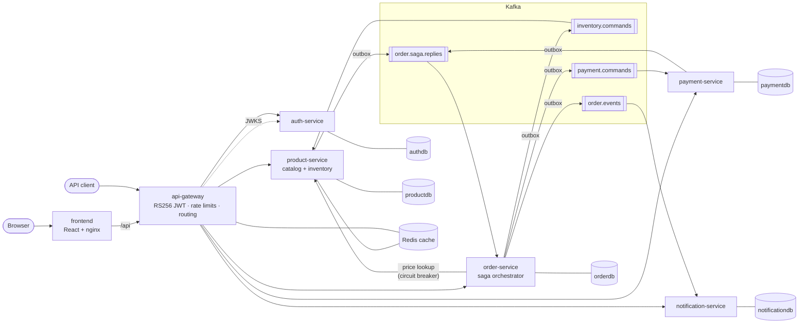
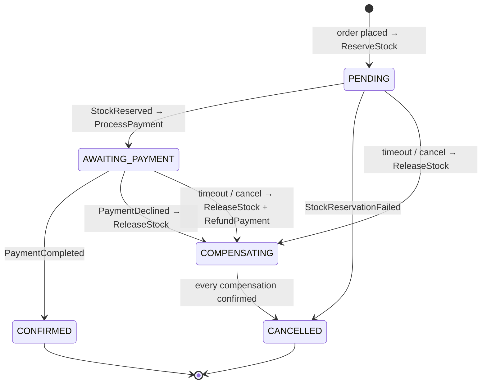
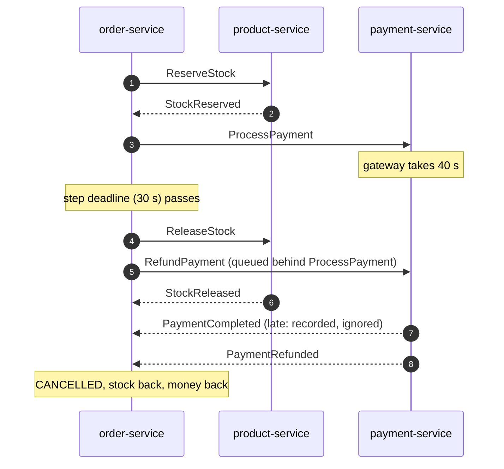

# ShopSaga — event-driven order platform

[](https://github.com/patilharsh01/ecommerce-microservices/actions/workflows/ci.yml)

An e-commerce backend built as seven Spring Boot 4 microservices. Every order is an **orchestrated saga** across
inventory and payments over Kafka, with real compensations, timeouts and exactly-once *effects* on top of at-least-once
delivery. A React console lets you place orders, watch each saga step land in real time, and break things on purpose.

The point isn't the shop. It's the failure handling that most "microservices demo" projects skip:

| Problem in distributed systems | How it's handled here |
|---|---|
| Saving to the DB and publishing to Kafka can't be atomic (dual write) | **Transactional outbox** + relay; events commit with the state change ([ADR 2](docs/adr/0002-transactional-outbox.md)) |
| Kafka redelivers messages after crashes and rebalances | **Idempotent consumers** via an inbox table in the same transaction ([ADR 3](docs/adr/0003-idempotent-consumers.md)) |
| A step fails after earlier steps succeeded | **Orchestrated saga** with compensations: release stock, refund or void payment ([ADR 1](docs/adr/0001-orchestrated-saga.md)) |
| A participant never answers | **Per-step deadlines** + sweeper; late replies are recorded and ignored safely ([ADR 6](docs/adr/0006-timeouts-and-late-replies.md)) |
| Two customers buy the last unit at the same instant | **Row locks in a fixed order** + `CHECK (stock >= 0)`; no oversell, no deadlocks ([ADR 4](docs/adr/0004-no-oversell.md)) |
| A customer double-clicks "Place order" or retries after a timeout | **`Idempotency-Key`** header, settled by a unique index |
| One malformed message blocks a partition forever | **Retry with back-off, then dead-letter topic** |
| The catalog service is slow or down | **Circuit breaker + retry** around the only synchronous call |
| Anyone can send `X-User-Id: 1` | Gateway **strips and re-derives identity** from an RS256 JWT; services aren't reachable directly ([ADR 5](docs/adr/0005-edge-authentication.md)) |

## Architecture



* **Database per service**, enforced with credentials: each service has its own Postgres database *and* login.
* **Commands go to the participant's topic, every reply comes back on one topic keyed by order id.** That keeps the replies for an order strictly ordered, which a topic-per-event layout can't guarantee.
* **Shared infrastructure lives in [`platform`](platform)**, a Spring Boot auto-configuration module: outbox, inbox, dead-lettering, trace propagation, RFC 9457 errors and identity resolution. Services contain only business code.

### The order saga



The worst case, and the one this design is built around: payment is slow, the saga times out, and *then* the charge succeeds.



Compensating commands are always queued **behind** the command they undo on the same partition, so a participant
handles "charge" before "refund" no matter how late it is. As a second line of defence, participants keep
**tombstones**: a refund that arrives before any charge voids the order, so a later charge is refused.

## Run it

Needs Docker with about 6 GB of memory available (on Windows that means WSL 2).

```bash
docker compose up -d --build --wait
```

| | |
|---|---|
| Shop and operations console | http://localhost:3000 (admin: `admin@shop.local` / `admin12345`) |
| API gateway and aggregated Swagger UI | http://localhost:8080/swagger-ui.html |
| Grafana, dashboard "Order Saga Overview" | http://localhost:3001 |
| Jaeger, one trace per order across every service | http://localhost:16686 |
| Prometheus and alert rules | http://localhost:9090/alerts |
| Eureka | http://localhost:8761 |
| Kafka UI with topics and dead-letter topics (optional) | `docker compose --profile tools up -d kafka-ui` → http://localhost:8090 |

### Things to try

1. **Happy path.** Order anything; the timeline shows reserve → charge → confirm within about a second.
2. **Payment declined.** Order more than ₹50,000. The payment is declined, the reserved stock is released, and the order is cancelled.
3. **Out of stock.** The ergonomic chair has 3 units. Order 5 and inventory rejects the reservation without touching stock.
4. **Timeout and late charge.** In *Operations → Failure lab*, set gateway latency to 40 s, then order. The saga times out at 30 s, compensates, and refunds the charge that eventually succeeds.
5. **Stock race.** Set a product's stock to 5 under *Catalog*, then *Failure lab → Stock race* fires 20 simultaneous orders at it: exactly 5 confirm, 15 are rejected, stock ends at 0.
6. **Kill a service.** `docker compose stop payment-service`, place an order, and start it again within 30 s: the order waits in `AWAITING_PAYMENT` and completes once it's back, because the command was durable in Kafka. Leave it down longer and the saga times out and releases the stock. When payment-service returns it processes the stale charge and then the queued refund, so the customer ends up refunded.

## Tests

| Layer | What | Where |
|---|---|---|
| Unit | State machine, orchestrator decisions, inventory and payment rules, codec, Indian currency formatting | `*Test.java` |
| Web slice | Validation, RFC 9457 errors, role checks, identity resolution, gateway access rules | `*ControllerTest`, `GatewaySecurityRulesTest` |
| Integration ([Testcontainers](https://testcontainers.com): real Postgres and Kafka) | Outbox ordering and rollback, inbox de-duplication, dead-lettering, **50 concurrent reservations for 10 units**, every saga path over Kafka, concurrent idempotent retries | `*IntegrationTest.java` |
| Frontend | API client, saga timeline, **checkout retries reuse the idempotency key** | `frontend/src/**/*.test.ts(x)` |
| End to end | Every saga path, idempotency, edge security and ownership against the full compose stack | [`scripts/e2e-smoke.sh`](scripts/e2e-smoke.sh) |
| Load | Constant-rate order placement, measuring both HTTP latency and full saga completion | [`load-test/place-orders.js`](load-test/place-orders.js) |

```bash
./mvnw verify                       # unit + integration (integration tests skip when Docker is absent)
(cd frontend && npm ci && npm test)
./scripts/e2e-smoke.sh              # against a running stack
docker run --rm -i --network ecommerce_backend -v "$PWD/load-test:/scripts" \
  -e BASE_URL=http://api-gateway:8080 grafana/k6:1.2.0 run /scripts/place-orders.js
```

CI ([`.github/workflows/ci.yml`](.github/workflows/ci.yml)) runs all of it: backend with Testcontainers, frontend, then the e2e suite against `docker compose`.

### Load test results

The whole platform (14 containers, single-node Kafka) on one desktop: Intel i7-12700, Docker Desktop on WSL 2 with
8 GB of memory. k6 runs in the same Docker network, placing single-item orders at a constant arrival rate and
following every tenth saga until it is CONFIRMED.

| Target rate | Orders | Failed requests | Place order p95 | Place order p99 | Full saga p95 |
|---|---|---|---|---|---|
| 50 orders/s for 1 min | 3,000 | 0% | 27 ms | 109 ms | 148 ms |
| 70 orders/s for 1 min | 4,201 | 0% | 36 ms | 116 ms | 117 ms |
| 100 orders/s for 1 min | 6,000 | 0% | 32 ms | 110 ms | 117 ms |

Every one of the 19,058 orders placed across the runs ended CONFIRMED. "Full saga" is placement to CONFIRMED:
reserve stock, charge, confirm, across three services and four Kafka hops through the outbox. The first minute after a
cold start is slower while the JVMs warm up.

The load test also found a real problem. On Kafka 4.1.0 the broker's group coordinator failed under load
(`Histogram recorded value cannot be negative` in `HighWatermarkUpdate`) and stopped committing offsets, so consumer
groups stalled and sagas timed out. The saga behaved as designed: it timed the orders out and compensated them. The
broker was upgraded to 4.1.2, where the problem doesn't occur.

## Security

* **RS256 tokens.** Only auth-service holds the private key. The gateway verifies signature, expiry, issuer and audience against the published [JWK Set](https://datatracker.ietf.org/doc/html/rfc7517), refetching on an unknown key id, so rotation needs no restart.
* **Identity at the edge.** The gateway removes any client-supplied `X-User-Id`/`X-User-Roles` before setting them from the verified token, and drops the bearer token, which stops at the edge. Services publish no ports, so the gateway is the only way in.
* **Authorization next to the data.** Role checks live in each service, and another customer's order or payment returns 404 rather than 403, so its existence isn't revealed.
* **Accounts.** Self-registration always creates customers (a `role` field in the body is ignored and tested). BCrypt cost 12. Unknown emails still pay for a hash comparison, so login timing doesn't reveal which accounts exist. Admins are provisioned from configuration.
* **Rate limiting.** Redis token buckets: 5/s per client IP on sign-in, 20/s per user on orders.
* **Least privilege in the database.** One login per service database; actuator runs on a separate, unpublished port.

## Observability

* **Metrics** (Prometheus): saga outcomes by cause, saga duration histogram, orders in flight by state, outbox backlog and age, inbox duplicates, dead letters, consumer lag, circuit-breaker state, payment gateway latency, HTTP percentiles.
* **Grafana dashboard** provisioned as code: [`infra/grafana/dashboards/order-saga.json`](infra/grafana/dashboards/order-saga.json).
* **Alerts**: sagas stuck compensating, outbox backlog (Kafka unreachable), dead letters, high cancellation rate, circuit open ([`alerts.yml`](infra/prometheus/alerts.yml)).
* **Distributed tracing** with OpenTelemetry into Jaeger. The outbox would normally break a trace (the relay publishes later, on another thread), so the W3C `traceparent` is stored on the outbox row and put back on the Kafka record. One order is one trace: gateway → order-service → Kafka → product-service → Kafka → payment-service.
* **Structured JSON logs** with trace id, span id, order id and message id on every line.

## Tech stack

| | |
|---|---|
| Language / runtime | Java 17, Spring Boot 4.0, Spring Framework 7, Spring Cloud 2025.1 |
| Messaging | Apache Kafka 4.1 (KRaft), Spring Kafka |
| Data | PostgreSQL 17, Flyway, Hibernate 7, Redis 7 |
| Edge | Spring Cloud Gateway (WebFlux), Spring Security OAuth2 resource server, Nimbus JOSE |
| Resilience | Resilience4j circuit breaker and retry, Spring Cloud LoadBalancer, Eureka |
| Observability | Micrometer, OpenTelemetry, Prometheus, Grafana, Jaeger |
| Frontend | React 19, TypeScript, TanStack Query, React Router, Vite |
| Testing | JUnit 5, AssertJ, Mockito, Testcontainers, Vitest, Testing Library, k6 |
| Delivery | Multi-stage Docker builds (layered jars, non-root), Docker Compose, GitHub Actions |

## Project layout

```
common/                 message contracts (Java records) and topic names, no dependencies
platform/               outbox, inbox, DLT, tracing, errors, identity — as Spring Boot auto-configuration
api-gateway/            JWT verification, identity headers, rate limiting, routing, Swagger UI
auth-service/           accounts, RS256 token issuing, JWK Set
product-service/        catalog (Redis-cached) and inventory saga participant
order-service/          order API, saga orchestrator, timeout sweeper
payment-service/        payment saga participant with a switchable simulated gateway
notification-service/   order events → customer notifications
discovery-server/       Eureka
frontend/               React storefront and operations console
infra/                  Postgres init, Prometheus rules, Grafana provisioning
scripts/, load-test/    end-to-end smoke test, k6 scenario
docs/adr/               architecture decision records
```

## Design decisions

1. [Orchestrated saga instead of choreography](docs/adr/0001-orchestrated-saga.md)
2. [Transactional outbox with an in-process relay](docs/adr/0002-transactional-outbox.md)
3. [Idempotent consumers with an inbox table](docs/adr/0003-idempotent-consumers.md)
4. [Preventing oversell](docs/adr/0004-no-oversell.md)
5. [Authentication at the edge with RS256](docs/adr/0005-edge-authentication.md)
6. [Saga timeouts and late replies](docs/adr/0006-timeouts-and-late-replies.md)

## Production gaps (deliberately out of scope)

* Kafka with replication factor 3 and `min.insync.replicas=2`; a schema registry with Avro or Protobuf instead of JSON.
* Secrets from a vault rather than environment variables; refresh tokens or a backend-for-frontend with httpOnly cookies.
* Kubernetes manifests or a Helm chart (Eureka would then be replaced by Kubernetes service discovery).
* Debezium change-data-capture as an alternative to the polling outbox relay at very high volume.
* Consumer-driven contract tests between orchestrator and participants.

## Troubleshooting

* **Docker Desktop on Windows** needs WSL 2. Run `wsl --install` from an administrator prompt and reboot.
* **`Unable to establish loopback connection` when starting a service locally on Windows.** The JDK opens an AF_UNIX socket in `%TEMP%`, which some security tools block. Point it elsewhere: `set JAVA_TOOL_OPTIONS=-Djdk.net.unixdomain.tmpdir=C:\some\other\folder`.
